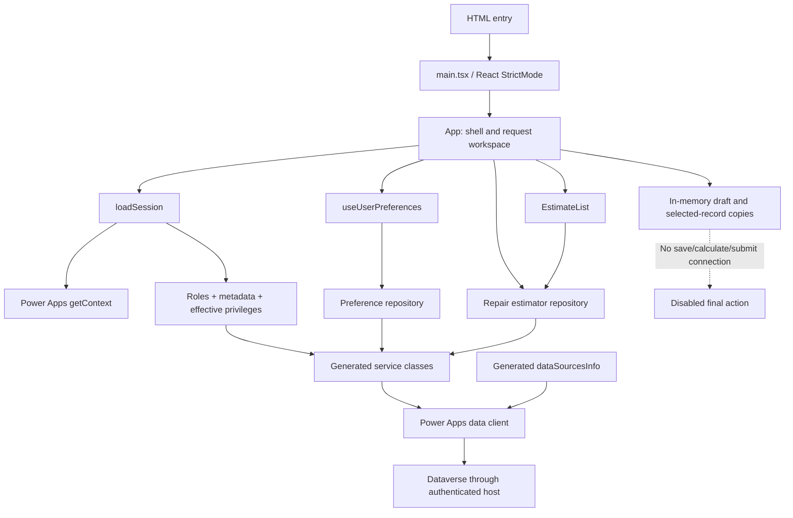

# Repair Estimator App: Master Architecture, Data Lineage, and Code Audit

**Audit date:** 2026-10-24  
**Repository baseline:** `4a51b4a0a8018ec0da91352fa86872a4a8a1f54f`  
**Method:** Read-only application inspection, local generated-schema analysis, existing automated tests, production build, and lint. Only this document was added.  
**Audience:** Developers, maintainers, business analysts, testers, and administrators.

## Contents

1. [Executive summary and evidence boundaries](#1-executive-summary-and-evidence-boundaries)
2. [Repository map and responsibilities](#2-repository-map-and-responsibilities)
3. [Runtime architecture and connection chain](#3-runtime-architecture-and-connection-chain)
4. [Startup, identity, roles, and capabilities](#4-startup-identity-roles-and-capabilities)
5. [Dataverse sources and relationship map](#5-dataverse-sources-and-relationship-map)
6. [Exact read-query contracts](#6-exact-read-query-contracts)
7. [User-preference reads and writes](#7-user-preference-reads-and-writes)
8. [Application state and lifetime](#8-application-state-and-lifetime)
9. [Five-step request workflow](#9-five-step-request-workflow)
10. [Field-by-field input lineage](#10-field-by-field-input-lineage)
11. [Choice values and localization](#11-choice-values-and-localization)
12. [Request-list rendering and pagination](#12-request-list-rendering-and-pagination)
13. [Errors, timeouts, retries, and asynchronous behavior](#13-errors-timeouts-retries-and-asynchronous-behavior)
14. [Generated contracts and dormant data surfaces](#14-generated-contracts-and-dormant-data-surfaces)
15. [Estimate schema dictionary](#15-estimate-schema-dictionary)
16. [Other business-entity schema dictionaries](#16-other-business-entity-schema-dictionaries)
17. [UI, accessibility, styling, and assets](#17-ui-accessibility-styling-and-assets)
18. [Build, environment, and deployment configuration](#18-build-environment-and-deployment-configuration)
19. [Audit findings, constraints, and documentation caveats](#19-audit-findings-constraints-and-documentation-caveats)
20. [Verification results and test coverage](#20-verification-results-and-test-coverage)
21. [Operational investigation and completion checklist](#21-operational-investigation-and-completion-checklist)
22. [Maintenance rules and glossary](#22-maintenance-rules-and-glossary)

## 1. Executive summary and evidence boundaries

### 1.1 What this application actually does

The application is a React/TypeScript **Power Apps Code App**, not a standalone application server. Its application data access goes through generated Microsoft Power Apps SDK services to Dataverse.

The current implementation has four distinct kinds of data:

| Data category | Source | Destination | Persistence |
| --- | --- | --- | --- |
| Identity and access | Authenticated Power Apps player, Dataverse role API, estimate privilege metadata/API | Session state, navigation gates, salesperson display | Memory for the mounted application |
| Existing business/reference records | Dataverse estimates, branches, equipment, standard packages, equipment types, job types | Read-only request lists, dropdowns, searches, selected-item previews | Dataverse remains authoritative; fetched/selected copies are in memory |
| New repair-request inputs | User entry and selected reference records | Five-step request workspace and review | **Not saved** |
| UI preferences | Dataverse preference row, then user changes | UI language, locale value, theme | **Read, created, and updated in Dataverse** |

**Most important distinction:** The application is not entirely read-only at runtime: preferences can be written automatically on startup. However, repair-estimate creation, updates, child-record creation, pricing, submission, approvals, and documents are not connected.

Dashboard headline metrics and charts are placeholders. The dashboard's request-list panel is a real Dataverse read surface.

### 1.2 What was verified

- Application source, repository helpers, generated models/service contracts, local Dataverse schema exports, configuration, tests, and existing documentation were inspected.
- The supplied read-only 1,331-line application snapshot was compared against the workspace's [App.tsx](src/App.tsx). The comparison found no content difference under Git's comparison. The snapshot was not edited.
- Existing tests: **22 passed, 0 failed**.
- Existing production build: **passed**.
- Existing ESLint command: **passed**.
- The worktree already contained a modified [package-lock.json](package-lock.json) before the audit. That pre-existing change was left untouched.

### 1.3 What this document does not claim

Local source proves what the browser attempts to do; it does not prove the current live environment has the expected data, roles, relationships, plugins, alternate keys, permissions, or business rules.

This audit did **not** sign in to the live player, query live customer records, create preferences in Dataverse, deploy the application, inspect server plugin implementations, validate a workbook, or change role assignments.

Evidence labels used throughout:

- **Implemented:** Directly demonstrated by the current application code.
- **Generated contract:** Present in local models/schema exports; may not describe every live relationship or enforcement rule.
- **Documented intent:** Asserted in the existing [README](README.md), but not independently established by executable source or a live inspection.
- **Unconnected:** A field/service exists, but the application does not execute that end-to-end workflow.
- **Recommended verification:** A follow-up check, not behavior already confirmed.

## 2. Repository map and responsibilities

| File or area | Responsibility and data significance |
| --- | --- |
| [index.html](index.html) | Static HTML entry, root mount element, title, description, viewport, and initial language/theme metadata |
| [main.tsx](src/main.tsx) | Imports global CSS and renders the app using React `createRoot` under `StrictMode` |
| [App.tsx](src/App.tsx) | Main shell; EN/FR copy; session/reference loading; market, branch, equipment, package and request state; wizard and review |
| [BranchSelect.tsx](src/BranchSelect.tsx) | Local accessible-branch combobox; filters already-loaded records; never queries Dataverse itself |
| [EstimateList.tsx](src/EstimateList.tsx) | Debounced list reads, filter state, continuation-token history, record rendering and read errors |
| [RequestFields.tsx](src/RequestFields.tsx) | Four declarative groups of editable/review fields using generated estimate choices; stores strings |
| [useUserPreferences.ts](src/useUserPreferences.ts) | Preference loading, optimistic changes, save serialization, readiness, errors, unsaved state, retry |
| [repairEstimatorRepository.ts](src/data/repairEstimatorRepository.ts) | Reference retrieval, branch paging, equipment/package queries, package date filtering, estimate summary reads |
| [sessionRepository.ts](src/data/sessionRepository.ts) | Player identity, app-role resolution, estimate metadata and effective Read/Create checks |
| [accessPolicy.ts](src/data/accessPolicy.ts) | Exact role names; role-response parsing; privilege validation; development-only override decision |
| [estimateQuery.ts](src/data/estimateQuery.ts) | Pure branch and estimate query builders; market/status validation; estimate search escaping |
| [dataverseOperation.ts](src/data/dataverseOperation.ts) | SDK-result unwrapping, structured error status, 15-second timeout wrapper |
| [userPreferences.ts](src/data/userPreferences.ts) | Preference transport abstraction, identity validation, lookup, parse/mapping, create/backfill/update |
| [generated index](src/generated/index.ts) | Exports generated service classes and model namespaces |
| [generated models](src/generated/models) | TypeScript shapes, enum values, lookup bindings and read representations |
| [generated services](src/generated/services) | SDK wrappers; existence of a method does not mean the app calls it |
| [generated data-source registry](.power/schemas/appschemas/dataSourcesInfo.ts) | Dataverse source keys, primary keys, and custom-operation route descriptions used by `getClient` |
| [Dataverse schema exports](.power/schemas/dataverse) | Local generated column types, labels, choices, length limits and navigation-property hints |
| [App.css](src/App.css), [index.css](src/index.css) | Layout, themes, form/list styling, responsive rules and focus presentation |
| [public assets](public), [source assets](src/assets) | Logo and leftover template SVG assets; not business-data sources |
| [integration-policy.test.mjs](tests/integration-policy.test.mjs) | Fifteen tests of policy, query builders, SDK result handling and timeout behavior |
| [user-preferences.test.mjs](tests/user-preferences.test.mjs) | Seven preference-repository tests using fake transports, not live Dataverse |
| [package.json](package.json), [package-lock.json](package-lock.json) | Dependency declarations/scripts and resolved dependency graph respectively |
| [power.config.json](power.config.json) | Power Apps application/environment identifiers, output entry and Dataverse source registration |
| [vite.config.ts](vite.config.ts) | React and Power Apps Vite plugins |
| [TypeScript app config](tsconfig.app.json), [Node config](tsconfig.node.json), [root config](tsconfig.json) | Strict compile settings, project boundaries and build references |
| [ESLint configuration](eslint.config.js) | TypeScript, React Hooks and React Refresh checks; excludes generated build output directory |
| [.env.development](.env.development) | Development-only Admin UI override flag |
| [.gitignore](.gitignore) | Ignores dependencies, build outputs, local variants and editor/log artifacts |
| [README](README.md) | Setup instructions, integration status, administrative recommendations and earlier design context |

## 3. Runtime architecture and connection chain

### 3.1 Business-data path



1. The browser loads the HTML and React module.
2. The Power Apps SDK obtains host-provided identity; there is no application-owned login form or browser token-management layer in this source.
3. Handwritten repository functions call generated services.
4. Each generated table service has a static `dataSourceName` and a static client initialized with `getClient(dataSourcesInfo)`.
5. The SDK uses source registration and the authenticated host to reach Dataverse.
6. SDK results return as `IOperationResult<T>`, not plain domain records.
7. `unwrap` either exposes the result's `data` or throws a `DataverseError`.
8. UI state receives the fetched records and renders or copies selected values.

The application contains no separate SQL connection, custom HTTP backend, Axios integration, manual Dataverse `fetch`, operational localStorage/sessionStorage store, or external pricing-service call in the inspected application source.

### 3.2 Layers that must not be confused

- A logical table name, entity-set name, configured source alias, service class, and field navigation property are different identifiers.
- A TypeScript model can include fields that a specific query does not request.
- A lookup's `_..._value` read property is not the same as its `...@odata.bind` write property.
- Generated CRUD capability is not implemented business workflow.
- Role-based UI gating is not server-side row authorization.
- Displaying user-entered sell price is not calculating or approving a quote.

## 4. Startup, identity, roles, and capabilities

Sources: [session repository](src/data/sessionRepository.ts), [access policy](src/data/accessPolicy.ts), [application](src/App.tsx).

### 4.1 Initial state

On first mount:

- View is `estimates`, meaning the dashboard.
- Market is `126110000` / MKO.
- Wizard step is 1.
- Branch, equipment type, job type and contact strings are empty.
- Equipment/package selections and results are empty arrays.
- `requestInputs` is an empty object; no business defaults are loaded.
- Session is undefined; session loading is true.
- Preference display defaults to English, `en-US`, System theme until its own load completes.
- OS dark-mode preference is read with `window.matchMedia`.

### 4.2 Exact session sequence

```text
getContext()
  -> require user.objectId AND user.systemUserId
  -> development override OR RetrieveAadUserRoles(objectId)
  -> resolve dedicated app role
  -> if no app role: return denied-capability session
  -> estimate getMetadata({ metadata: ['Privileges'] })
  -> find unique Read and Create privilege names
  -> parallel effective Read and Create queries for systemUserId
  -> validate responses
  -> build AppSession
```

Identity field lineage:

| Player field | Meaning/use in this code | Destination |
| --- | --- | --- |
| `user.objectId` | Entra directory object identifier | Argument to role retrieval |
| `user.systemUserId` | Linked Dataverse user identifier | Effective privilege queries, `session.userId`, preference User lookup |
| `user.fullName` | Display label, falling back to empty string | Sidebar, read-only salesperson, preference record name |

Missing either required ID throws an explicit linked-identity error. A CLI login or ordinary localhost page is not sufficient evidence of authenticated browser player context.

### 4.3 Role resolution

Only exact, case-sensitive names count:

| Role name | Resolved role |
| --- | --- |
| `Repair Estimator - Estimator` | `estimator` |
| `Repair Estimator - Admin` | `admin` |
| Both | `admin` |
| None, unrelated `Admin`, unrelated `Estimator`, or `System Administrator` | `null` |

Role parsing accepts an array or an object whose `value` is an array. Every role row must be a non-null object containing a string `name`. Malformed responses are errors, not an empty-role fallback.

### 4.4 Metadata and privilege checks

The repository asks estimate metadata for `Privileges` rather than inventing privilege names from the table name.

- Read matches `PrivilegeType` equal to numeric `2` or string `Read`.
- Create matches numeric `1` or string `Create`.
- Exactly one matching metadata entry per capability must exist, with a nonblank `Name`.
- Each effective privilege request uses `systemUserId`, the metadata-derived name, and `ExcludeTeamBasic=false`.
- A valid response has a `RolePrivileges` array.
- Every entry needs a nonempty string `PrivilegeId` and accepted depth: `0`, `1`, `2`, `3`, `Basic`, `Local`, `Deep`, or `Global`.
- An empty array denies that capability; any valid nonempty array grants the presence check. The UI does not translate depth into its own row filtering.

Final capabilities:

```text
canReadEstimates = valid nonempty effective Read privileges
canStartEstimate = canReadEstimates AND valid nonempty effective Create privileges
```

These are not checks for estimate Write, Append, Append To, child creation, preference permissions, approval authority, or complete draft-save readiness.

Both effective privilege queries must complete successfully for `loadSession` to return. A Create-check transport error can therefore fail session loading even if a separate Read check would have succeeded.

### 4.5 Development Admin override

The inspected [.env.development](.env.development) contains `VITE_DEV_ADMIN_OVERRIDE=true`.

The override activates only when `import.meta.env.DEV` is true **and** the setting is the exact string `true`.

It bypasses role discovery, not identity validation, metadata inspection, privilege checks, or Dataverse authorization. A visible banner describes the override. Production builds ignore it. Admin-only menu placeholders remain disabled.

### 4.6 What starts after session resolution

- A readable session mounts a request list on the dashboard or Repair Requests view.
- A session with `canStartEstimate=true` starts branch loading and request-reference loading, even while the dashboard is visible.
- Any returned session with a user ID starts preference initialization, **including a session with no app role**.
- Preference readiness is not required to enable New Request; it gates the topbar market/theme/language controls.
- No automatic timer revalidates the role/capabilities. Reload after role or privilege changes.

## 5. Dataverse sources and relationship map

Sources: [Power Apps configuration](power.config.json), [source registry](.power/schemas/appschemas/dataSourcesInfo.ts), [generated models](src/generated/models).

### 5.1 Registered table/source names

| Configuration alias | Logical table | Entity set / generated source key | Primary ID | Current application use |
| --- | --- | --- | --- | --- |
| `branches` | `re_branch` | `re_branchs` | `re_branchid` | Active branch reads and market/country context |
| `equipment` | `re_equipment` | `re_equipments` | `re_equipmentid` | Branch-scoped active equipment search |
| `repairpackages` | `re_repairpackage` | `re_repairpackages` | `re_repairpackageid` | Country/global standard-package search |
| `repairestimates` | `re_repairestimate` | `re_repairestimates` | `re_repairestimateid` | Summary list and privilege metadata |
| `estimateequipments` | `re_estimateequipment` | `re_estimateequipments` | `re_estimateequipmentid` | Generated only; no UI read/write |
| `estimatepackages` | `re_estimatepackage` | `re_estimatepackages` | `re_estimatepackageid` | Generated only; no UI read/write |
| `equipmenttypes` | `re_equipmenttype` | `re_equipmenttypes` | `re_equipmenttypeid` | Active bilingual request options |
| `jobtypes` | `re_jobtype` | `re_jobtypes` | `re_jobtypeid` | Active bilingual request options |
| `appuserpreferences` | `re_appuserpreference` | `re_appuserpreferences` | `re_appuserpreferenceid` | Load/create/backfill/save preferences |
| `securityroles` | `role` | `roles` | `roleid` | Generated CRUD unused; roles obtained through operation API instead |
| `user` | `systemuser` | `systemusers` | Not declared as a generated table source here | Host user identity, preference bind, bound privilege operation |
| `environment_39a902ba` | `environment_39a902ba` | `Environment` | Not declared as a generated table source here | Registered in configuration; no direct UI read |

The last two registrations do not have corresponding entity service classes in the inspected generated service directory.

### 5.2 Relationship meanings

| Relationship/context | Read property or binding | Actual use |
| --- | --- | --- |
| Equipment -> Branch | Equipment `_re_branch_value`; write form `re_Branch@odata.bind` | Used in equipment filter; binding not written |
| Branch -> Country | Branch `_re_country_value`; `re_Country@odata.bind` | Country ID scopes package search |
| Repair Package -> Country | Package `_re_country_value`; `re_Country@odata.bind` | Exact country or null/global package accepted |
| Preference -> User | `_re_user_value`; `re_User@odata.bind` | Lookup filter and `/systemusers(<signed-in-id>)` on create |
| Estimate -> Branch | `_re_branch_value`; `re_Branch@odata.bind` | Contract exists; current workspace does not save it |
| Estimate -> Equipment Type | `_re_equipmenttype_value`; `re_EquipmentType@odata.bind` | Selected ID stays in React state |
| Estimate -> Job Type | `_re_jobtype_value`; `re_JobType@odata.bind` | Optional selected ID stays in React state |
| Estimate -> Salesperson | `_re_salesperson_value`; `re_Salesperson@odata.bind` | Host display name shown, but no create binding emitted |
| Estimate Package -> Estimate | `_re_repairestimate_value`; `re_RepairEstimate@odata.bind` | Generated optional parent binding; unused |
| Estimate Package -> Repair Package | `_re_repairpackage_value`; `re_RepairPackage@odata.bind` | Generated required package binding; unused |
| Estimate Equipment -> Estimate/Equipment | No corresponding lookup/binding exposed in the local model | Relationship cannot be safely constructed from this contract |

Other branch relationships include Currency, State/Province, Margin Group, and optional Mapped Equipment Branch. These are present in the contract but not selected by the branch repository query.

**Important non-join:** Equipment sold-to name/location are displayed on selected units. They do not populate review customer name, contact fields, building name, sold-to number, bill-to, or payer.

## 6. Exact read-query contracts

Sources: [repository](src/data/repairEstimatorRepository.ts), [query builders](src/data/estimateQuery.ts).

### 6.1 Active branches

| Property | Exact behavior |
| --- | --- |
| Select | `re_branchid`, `re_branchname`, `re_branchnumber`, `re_market`, `_re_country_value` |
| Filter | `statecode eq 0` |
| Sort | `re_branchname asc`, then `re_branchid asc` |
| Page size | 500 |
| Total cap | No `top`; all returned pages are followed |
| Continuation | `skipToken` from each result passed to the next query |
| Loop protection | Repeated nonempty continuation token throws |
| Market restriction | Applied **locally after retrieval**, not in this query |

All accessible active branches are accumulated before the UI receives the result. If any page fails, the function rejects rather than returning a partial list. The timeout is per request/page, not a single 15-second budget for the entire multi-page operation.

`re_marketname` is deliberately not selected. The generated label property is not treated as a normal selectable column.

### 6.2 Request reference options

Two queries start in parallel:

| Entity | Selected fields | Filter | Sort |
| --- | --- | --- | --- |
| Equipment types | `re_equipmenttypeid`, `re_nameen`, `re_namefr` | `statecode eq 0` | `re_nameen asc` |
| Job types | `re_jobtypeid`, `re_jobtypeen`, `re_jobtypefr` | `statecode eq 0` | `re_jobtypeen asc` |

Each requests `maxPageSize=500`, without `top`. Unlike branches, these lists do **not** follow continuation tokens. If either response has a token, the entire reference load throws an explicit unsupported-paging error.

Rows map to `{ id, en, fr }`. French display uses `fr || en`. The English sort order is preserved in French. Job-type rating and equipment-type fixed target CMII are not fetched.

### 6.3 Equipment search

Trigger: selected branch, trimmed query of at least **3 characters**, **300 ms** debounce.

```text
statecode eq 0
and _re_branch_value eq <branchId>
and (
  startswith(re_equipment,'<escaped search>')
  or startswith(re_equipmentname,'<escaped search>')
)
```

Selects:

- `re_equipmentid`
- `re_equipment`
- `re_equipmentname`
- `re_functionallocation`
- `re_soldtoname`
- `re_oem`
- `re_equipmentage`

Sort is `re_equipment asc`; `top=20` and `maxPageSize=20`. There is no continuation UI.

Single quotes in search text are doubled. Branch IDs originate from loaded branch records; this repository function does not separately validate their GUID format.

This is prefix search, not substring search. It does not filter by customer, equipment type, job type, mapped-equipment branch, or salesperson.

### 6.4 Standard package search

Trigger: selected branch has a country, trimmed query of at least **2 characters**, **300 ms** debounce.

```text
statecode eq 0
and re_iscustompackage eq false
and re_istimematerial eq false
and (_re_country_value eq <branchCountryId> or _re_country_value eq null)
and (
  startswith(re_packagenumber,'<escaped search>')
  or startswith(re_packagenameen,'<escaped search>')
)
```

Selected fields:

`re_repairpackageid`, `re_packagenumber`, `re_packagenameen`, `re_packagenamefr`, `re_proposalscopeen`, `re_proposalscopefr`, `re_mechanichours`, `re_effectivefrom`, `re_effectiveto`.

Sort is `re_packagenumber asc`; `top=20` and `maxPageSize=20`. Apostrophes are escaped.

**Second filtering stage in the browser:**

```text
today = current UTC date as YYYY-MM-DD
startsOn = effective-from string's first 10 characters
endsOn = effective-to string's first 10 characters, if present
keep when startsOn <= today AND (no endsOn OR endsOn >= today)
```

Both boundaries are inclusive. This assumes valid generated-contract date strings. It is not a local-market timezone calculation.

The date filter runs **after** the top-20 server cap. Thus zero displayed results do not prove the catalog has no eligible package beyond those first 20 matches.

No currency, equipment-type, package-category or job-type filter is applied. French names are displayed when available but are not searched. French proposal scope is fetched but the result preview renders English proposal scope.

Mechanic hours are fetched and retained in selected records; no hours multiplication or financial calculation uses them.

### 6.5 Existing estimate summaries

Always includes `statecode eq 0`.

Optional conditions:

- If market is supplied: `re_market eq <market>`, after validating one of the three supported numeric market values.
- Trimmed nonempty search: prefix match across `re_name`, `re_customername`, or `re_buildingname`.
- Nonempty status: `re_estimatestatus eq <status>`, after validating the three permitted status strings.

Selects only:

`re_repairestimateid`, `re_name`, `re_estimatename`, `re_customername`, `re_buildingname`, `re_estimatestatus`, `createdon`.

Sort: `createdon desc`, then `re_repairestimateid asc`. Page size: 25. No `top`, count request, client-wide download, or aggregate calculation.

The app always supplies the current market. The builder can also be called without one, as covered in tests.

**Naming detail:** The search does not match `re_estimatename`, even though that field is displayed as the secondary Request value.

## 7. User-preference reads and writes

Sources: [preference repository](src/data/userPreferences.ts), [hook](src/useUserPreferences.ts), [preference service](src/generated/services/Re_appuserpreferencesService.ts).

### 7.1 Identity and lookup

A user ID must match the canonical GUID-shaped regex before repository access.

Find query:

| Option | Value |
| --- | --- |
| Select | Preference ID, name, language, locale, theme, `statecode` |
| Filter | `_re_user_value eq <signed-in Dataverse user ID>` |
| Limit | `top=2`, `maxPageSize=2` |
| Duplicate handling | More than one row **or any continuation token** throws |
| Inactive handling | A defined nonzero `statecode` throws |

There is deliberately no active-state filter: an inactive row becomes an error instead of being hidden and replaced.

### 7.2 Initialization branches

```text
loadOrCreate(userId, displayName)
  -> validate userId
  -> reuse pending initialization for this user, if present
  -> find user's preference row
     -> existing: parse; backfill missing name/locale/theme if needed
     -> absent: create English/en-US/System active preference bound to user
  -> clear pending-initialization map entry after settlement
```

The module-level hook repository shares an in-flight initialization map. This deduplicates concurrent initializations in that repository instance, including overlapping React startup calls. It is not a permanent cache or cross-tab lock.

### 7.3 Create payload

| Column | Value |
| --- | --- |
| `re_name` | Display name, otherwise user ID, truncated to 200 characters |
| `re_User@odata.bind` | `/systemusers(<userId>)` |
| `statecode` | `0` |
| `re_preferredlanguage` | `126110000` / English |
| `re_preferredlocale` | `en-US` |
| `re_preferredtheme` | `126110000` / System |

No estimate field, owner field, market, or proposal-language field is included.

### 7.4 Parsing and legacy backfill

- Language must be English or French choice value; otherwise initialization fails.
- A non-null theme must be System, Dark or Light; otherwise it fails.
- Missing/empty locale becomes `fr-CA` for French or `en-US` for English.
- Missing theme becomes System.
- Missing name, locale, or theme triggers an update of name and all mapped preference values.
- Existing complete rows are loaded without being reset or rewritten.
- Arbitrary nonempty saved locales are retained; the code does not validate them against a locale allowlist or the schema's 10-character limit.

### 7.5 Save and UI behavior

1. The hook accepts a save only when the user has loaded preferences and another save is not running.
2. It sets `busy`, saves a pending value, marks it unsaved, and immediately updates visible UI preferences.
3. The repository re-finds the row instead of holding a permanently cached record ID.
4. A missing row throws; save does not silently recreate it.
5. The update sends only language, locale and theme.
6. Success clears pending/unsaved state.
7. Failure leaves the optimistic UI value visible and displays the error/unsaved notice.
8. Retry replays the pending save; when no save is pending it retries initialization.

Topbar selectors are disabled until ready and while saving. Initial preference loading does not use the `busy` flag; readiness controls that state.

There is no ETag/version-based update conflict strategy. Writes from different browser sessions can overwrite one another.

### 7.6 Language, locale, market, theme: separate concepts

| Concept | Stored? | Behavior |
| --- | --- | --- |
| UI language | Preference row | EN/FR text and reference/package labels |
| Preference locale | Preference row | Updated with manual language changes; retained in hook |
| Date-display locale | Derived from UI language | Request dates use `fr-CA` or `en-US`, not arbitrary saved locale |
| HTML language | Derived from UI language | `document.documentElement.lang` becomes `fr-CA` or `en-US` |
| Market | Memory only | MKO/CKE/CKQ branch and estimate filtering |
| Proposal language | Unsaved request input | Independent choice; no automatic UI-language synchronization |
| Theme | Preference row | System, Dark or Light |
| Effective dark mode | Derived locally | Dark, or System plus OS dark preference |

Selecting CKQ saves French/`fr-CA` while preserving theme. Selecting MKO/CKE does not force English. Returning from CKQ leaves French selected unless the user changes it.

The existing README describes a User alternate key preventing duplicate preference rows. The inspected schema export does not establish that alternate key; live metadata must verify it. The local in-flight map alone does not prevent cross-browser duplicate creation.

## 8. Application state and lifetime

Source: [App.tsx](src/App.tsx).

| State group | Variables | Producers | Consumers/lifetime |
| --- | --- | --- | --- |
| Workspace | `view`, `market`, `step` | Navigation, market selector, wizard footer | Conditional rendering; survives in-app view changes |
| Session | `session`, loading/error/attempt | `loadSession`, retry | Access messages, navigation, list visibility, read-only salesperson, preferences |
| Branches | `branches`, loading/error, `branchId` | Paged reads, combobox | Market options, equipment branch filter, package country, summary |
| Reference data | `references`, error/attempt | Parallel type/job reads | Bilingual selects; selected IDs held separately |
| Equipment search | Query/results/loading/error | Input handlers, debounced effect | Search rows, unlisted entry, loading/error states |
| Selected equipment | `selectedEquipment` | Match/unlisted add and remove | Counts, limits, step gate, selected cards, review |
| Package search | Query/results/loading/error | Input handlers, country-dependent effect | Search rows and package selection |
| Selected packages | `selectedPackages` | Add/remove | Maximum-three gate, review, retained catalog values |
| Request header IDs | `equipmentTypeId`, `jobTypeId` | Dropdowns | Step-one gate and unsaved-change detection |
| Manual identity/contact | Building/customer/email/phone strings | Opportunity/review inputs | Review and unsaved-change detection |
| Dynamic inputs | `requestInputs` | `RequestFields` callbacks | All four field groups and read-only review |
| Theme | OS preference state; hook theme | `matchMedia` changes, preference saves | HTML `data-theme` attribute |
| DOM reference | `requestSection` | React ref | Step focus and input `reportValidity()` calls |

Derived values:

- `selectedBranch`: first loaded branch matching `branchId`.
- `marketBranches`: loaded branches whose numeric `re_market` matches market.
- `marketName`: MKO, CKE or CKQ.
- `selectedPackageIds`: memoized set of selected package GUIDs.
- `canStart`: session's `canStartEstimate` is exactly true.
- `hasUnsavedChanges`: preference unsaved/busy **or** branch/building/customer/contact/type/job values **or** any truthy request-input string.

No reducer, global state store, router, URL-backed view/filter state, draft serialization, server draft ID, or resumable draft object exists.

### 8.1 Navigation and reset matrix

| Action | Changes | Preserves |
| --- | --- | --- |
| Dashboard / Repair Requests navigation | `view`; list unmount/remount as applicable | All application-level request inputs and selections |
| New Request | Step becomes 1; view becomes `new` | Existing request fields and selections; it is not a blank-new-draft reset |
| Wizard Back | Previous step, or dashboard from step 1 | Existing entered values |
| Branch change | Branch, queries/results/errors/loading, equipment selections, package selections | Building/contact/type/job/request-input values |
| Branch change with any selected unit/package | Confirmation before reset | Everything if cancelled |
| Market change | Clears branch/equipment/packages/search state; changes market; resets step to 1 | Other request details; current view |
| Market change when a branch is selected | Confirmation before applying | Market, language and draft unchanged if cancelled |
| CKQ market change | Above plus preference save to French/`fr-CA` | Theme and proposal-language input |
| Refresh/close | Browser unload warning when dirty | No request recovery after actual unload |

Market changes remount request lists via `key={market}`, resetting search, status, page tokens and records.

The unload warning is not a save. It is not shown for every nondefault workspace state: market-only changes and typed search text are not part of `hasUnsavedChanges`. Selected arrays are not checked directly, although normal selection requires a branch, which is checked.

## 9. Five-step request workflow

### 9.1 Step 1: Opportunity details

Shows branch, equipment type, optional job type, read-only signed-in salesperson, building name and request questions.

Continue is disabled unless:

```text
branchId is nonempty
AND buildingName.trim() is nonempty
AND equipmentTypeId is nonempty
```

No job type, proposal language, technician count, or other dynamic field is required by this button gate.

Branch options are the current market's loaded active accessible records. Branch names are displayed as `name (number)`.

### 9.2 Step 2: Equipment and standard packages

Equipment and package selection appear on the same wizard step.

**Matched equipment transformation:**

| Selected property | Source |
| --- | --- |
| `id` | `re_equipmentid` |
| `number` | `re_equipment` |
| `name` | `re_equipmentname ?? ''` |
| `location` | `re_functionallocation` |
| `customer` | `re_soldtoname ?? ''` |
| `oem` | `re_oem ?? ''` |
| `age` | `re_equipmentage` |
| `matched` | `true` |

Selection maximum is **14 units**. Duplicate prevention compares equipment-number strings, not IDs, using case-sensitive equality.

**Unlisted equipment:**

- UI offers it for a trimmed query of at least three characters when not loading and without search error.
- It can be offered even if matching records exist.
- The number is the trimmed typed query.
- The local ID is `unlisted-` plus `crypto.randomUUID()`.
- Name/location/customer/OEM are empty, age is absent, and `matched=false`.
- It is explicitly labelled unbound; no equipment master row is created.
- The add handler separately enforces nonempty number, duplicate-number rejection and maximum 14.

**Packages:**

- Maximum **3** standard packages.
- Duplicate prevention is by `re_repairpackageid`.
- Full selected query-result objects are retained in memory.
- Package search is disabled without branch country or after three selected packages.
- Removing a package reopens capacity; it does not clear unrelated request inputs.

Continue requires at least one equipment item and at least one package. This step cannot currently continue with a package-free custom/T&M request.

### 9.3 Step 3: Cost inputs

Captures time category, additional labor hours, material, miscellaneous, use-tax %, freight %, and additional scope.

No defaults are read from branch, no package costs are totaled, and no calculations are executed. Percentages are presented as whole percent units, for example `5` means 5%.

### 9.4 Step 4: Pricing and margin

Captures entered sell price, billing plan and margin comments.

There is no suggested-price calculation, CMII calculation, incentive calculation, approval routing, or comparison of entered versus recommended price.

### 9.5 Step 5: Review and customer/partner details

- Customer name, email and phone are editable here.
- Building name edits the **same state variable** used at opportunity stage.
- Partner account identifiers and CTT notes are editable.
- Summary shows branch, unit/package counts, selected units and packages.
- Request/cost/pricing groups appear in expandable read-only sections.
- Final action is permanently disabled and labelled Not saved.

No estimate object, child payload, snapshot, document or submission request is emitted.

### 9.6 Validation actually performed

Before advancing from steps 1-4, the footer queries all `input` elements inside the request section and calls `reportValidity()`.

Consequences:

- HTML numeric bounds and integer steps can block progression for populated invalid inputs.
- Empty optional inputs normally remain valid.
- Selects and textareas are not part of that validation loop.
- The wizard is not a submitted HTML form.
- Dynamic select fields are not marked `required`, even where the generated create contract requires a value.
- Final review has no enabled action that validates contact values or the changed building name.

This is input capture, not complete server-contract validation.

## 10. Field-by-field input lineage

Sources: [RequestFields.tsx](src/RequestFields.tsx), [App.tsx](src/App.tsx), [estimate model](src/generated/models/Re_repairestimatesModel.ts).

### 10.1 Shared input representation

`RequestInputs` is a partial map from the defined field keys to **strings**. Number controls and numeric choice controls still store string values from DOM events. No numeric/choice conversion or Dataverse save mapper exists.

The generated estimate field names provide semantic alignment; they do not create an automatic binding or persistence layer.

### 10.2 Opportunity and reference fields outside RequestInputs

| UI value | Origin | In-memory destination | Related estimate field, not currently written |
| --- | --- | --- | --- |
| Market | Topbar selection; initially MKO | `market` | `re_market` |
| Branch | Accessible active branch row | `branchId`; derived `selectedBranch` | `re_Branch@odata.bind` |
| Equipment type | Active equipment-type reference ID | `equipmentTypeId` | `re_EquipmentType@odata.bind` |
| Job type | Active job-type reference ID | `jobTypeId` | `re_JobType@odata.bind` |
| Salesperson display | Player `fullName` | Read-only rendering from session | `re_Salesperson@odata.bind` would need user ID, not name |
| Building name | Manual opportunity/review input | `buildingName` | `re_buildingname` |
| Customer name | Manual review input | `customerName` | `re_customername` |
| Customer email | Manual review input | `customerEmail` | `re_customeremail` |
| Customer phone | Manual review input | `customerPhone` | `re_customerphone` |
| Equipment count | Selected array length | Derived display | `re_numberofequipment` |

Building name has `maxLength=300` at step 1, but no maximum on its step-5 input. Customer/contact inputs have no maximum lengths even though the local schema gives 100/100/50 characters for name/email/phone.

### 10.3 Request group: step 1

| Field key | User meaning | Control and current browser constraints |
| --- | --- | --- |
| `re_supervisor` | Optional supervisor | Text, max 100 |
| `re_workcenterrequest` | Requested Route/Repair work centre | Choice select |
| `re_numberoftechs` | Technician count | Number; min 1, max 3, step 1 |
| `re_hasbeenapproved` | Approval indication | Yes/No/Unknown select; does not approve anything |
| `re_nationalaccount` | National-account indication | Yes/No/Unknown select |
| `re_emergency` | Emergency/unit shutdown | Yes/No select |
| `re_subcontractorcost` | Entered subcontractor cost | Number; min 0, step any |
| `re_customerbudgeted` | Customer budgeted repair | Yes/No select |
| `re_papertype` | Customer/KONE/NA paper | Choice select |
| `re_consultantinvolved` | Consultant involvement | Yes/No select |
| `re_competingbids` | Competition knowledge | None/Known/Suspected/Unknown select |
| `re_statedlaborrate` | Entered billing rate/hour | Number; min 0, step any |
| `re_proposallanguage` | Proposal language | English/French select; independent of UI language |

### 10.4 Cost group: step 3

| Field key | Meaning | Control and current browser constraints |
| --- | --- | --- |
| `re_timecategory` | Labor time category | Straight Time/Double Time select |
| `re_additionallaborhours` | Additional hours | Number; min 0, step any |
| `re_additionalmaterial` | Additional material amount | Number; min 0, step any |
| `re_additionalmiscellaneous` | Additional miscellaneous amount | Number; min 0, step any |
| `re_usetax` | Entered use-tax percentage | Number; min 0, max 100, step any |
| `re_freight` | Entered freight percentage | Number; min 0, max 100, step any |
| `re_additionalscope` | Additional scope text | Textarea; no UI maximum; schema max 10,000 |

The README specifies future conversion of displayed percentages to the v3.2 0-1 rate representation. That conversion is **not implemented**. The local schema exports identify decimal columns but do not themselves prove the 0-1 live bounds. Verify the external design/live metadata before implementing writes.

`re_usetaxpercentage` and `re_freightpercentage` are different generated fields and are not the fields captured by these controls.

### 10.5 Pricing group: step 4

| Field key | Meaning | Control and current browser constraints |
| --- | --- | --- |
| `re_sellprice` | Entered proposed sell price | Number; min 0, step any |
| `re_billingplan` | Billing arrangement | Choice select |
| `re_margincomments` | Comments on booked/recommended margin | Textarea; no UI maximum; schema max 2,000 |

### 10.6 Partner group: step 5

| Field key | Meaning | Control and current browser constraints |
| --- | --- | --- |
| `re_prospectaccount` | Prospect account number | Text, max 50 |
| `re_soldto` | Sold-to identifier | Text, max 50 |
| `re_billto` | Bill-to identifier | Text, max 50 |
| `re_payer` | Payer identifier | Text, max 50 |
| `re_notesforcttteam` | CTT notes | Textarea; no UI maximum; schema max 4,000 |

These identifiers are manual strings, not resolved account lookups. The selected equipment's customer name does not write them.

## 11. Choice values and localization

Source of business choices: [generated estimate model](src/generated/models/Re_repairestimatesModel.ts). Source of translated form labels: [RequestFields.tsx](src/RequestFields.tsx). Source of page copy: [App.tsx](src/App.tsx) and [EstimateList.tsx](src/EstimateList.tsx).

### 11.1 Choices used by the current input UI

| Field(s) | Exact numeric choices |
| --- | --- |
| `re_workcenterrequest` | `126110000` Route; `126110001` Repair |
| `re_hasbeenapproved`, `re_nationalaccount` | `126110000` Yes; `126110001` No; `126110002` Unknown |
| `re_emergency`, `re_customerbudgeted`, `re_consultantinvolved` | `126110000` Yes; `126110001` No |
| `re_papertype` | `126110000` Customer Paper; `126110001` Kone Paper; `126110002` NA |
| `re_competingbids` | `126110000` None; `126110001` Known; `126110002` Suspected; `126110003` Unknown |
| `re_proposallanguage` | `126110000` English; `126110001` French |
| `re_timecategory` | `126110000` Straight Time; `126110001` Double Time |
| `re_billingplan` | `126110000` 50% / 50%; `126110001` 60% / 40%; `126110002` Final 100%; `126110003` Other: See Notes |

### 11.2 Other important choices

| Field/category | Values |
| --- | --- |
| Market | `126110000` MKO - United States; `126110001` CKE - Canada (English); `126110002` CKQ - Quebec |
| Estimate status | `126110000` Draft; `126110001` Pending; `126110002` Submitted |
| Preference language | `126110000` English; `126110001` French |
| Preference theme | `126110000` System; `126110001` Dark; `126110002` Light |
| Active state | `statecode=0` Active; `statecode=1` Inactive |
| Active status reason | `statuscode=1` Active; `statuscode=2` Inactive on these custom table contracts |
| Approval level | `126110000` None; `126110001` District; `126110002` Regional |
| Estimate path | `126110000` Standard Package; `126110001` Custom Estimate |
| Estimate type | `126110000` Standard Estimate; `126110001` Custom Estimate |
| Estimate language | `126110000` English; `126110001` French; distinct from proposal language |
| Quote type | `126110000` QR; `126110001` QQ |
| Primary equipment found | `126110000` Yes; `126110001` No |
| Band/rating choices | `126110000` High; `126110001` Medium; `126110002` Low |

Band/rating choices cover customer, customer-base, equipment, equipment-age, job-type band/rating, national-account band, OEM, redundancy, and vertical. Job-type master rating uses the same High/Medium/Low values.

### 11.3 Localization limits

- Field choices are generated numeric-to-English string maps. French rendering uses a local translation dictionary, falling back to the original string.
- Equipment-type/job-type French names and package French names fall back to English.
- Package scope preview is English even when the UI is French.
- Branch labels are names/numbers, not translated market labels.
- Some decorative headings, navigation ARIA text, and raw backend/error fallback messages remain English.
- UI language does not rewrite saved business records, translate equipment master names, select proposal language, or modify market.

## 12. Request-list rendering and pagination

Source: [EstimateList.tsx](src/EstimateList.tsx).

The same list component appears on the dashboard and Repair Requests view, conditionally mounted rather than shared as one persistent instance.

### 12.1 Local list state

- Search string, initially empty.
- Status string, initially empty/all.
- Token stack, initially `[undefined]`.
- Next-token value from the current response.
- Current records, loading state, error descriptor and retry counter.
- Current query's `skipToken` is the final element of the token stack.

Every query is delayed 300 ms, including initial loading, retry and page navigation.

### 12.2 Display lineage

| Display element | Source and fallback |
| --- | --- |
| React record key | `re_repairestimateid` |
| Heading | `re_name || re_estimatename` |
| Status | Local map of `re_estimatestatus`; unknown numeric value gets Unknown status |
| Request detail | `re_estimatename ||` dash placeholder |
| Customer | `re_customername ||` dash placeholder |
| Building | `re_buildingname ||` dash placeholder |
| Created | `createdon` parsed with `Date`, rendered by `Intl.DateTimeFormat` in language-derived locale |

The date display uses the browser's default timezone; the code supplies no fixed timezone. A malformed nonempty timestamp can throw during formatting; the network promise's catch does not wrap rendering.

There is no detail navigation, edit link, attachment access, price display or save operation in a request card.

### 12.3 Filter and page transitions

- Search is limited to 150 characters by the input.
- Changing search or status sets loading, clears next token and resets token history.
- Next pushes the current response's continuation token.
- Previous pops one token.
- Returning to an earlier page re-queries it; records are not cached per page.
- Page number is token-stack length, not a total-page count.
- Next is disabled without a token; Previous is disabled on the first token.
- Changing market remounts the component, resetting all its local state.
- Changing language rerenders labels/dates; language is not an effect dependency, so it does not refetch records.
- Switching dashboard/requests loses list filter/paging state because that component instance unmounts.

No totals are inferred from a page. A page of 25 records is not evidence of 25 total estimates.

## 13. Errors, timeouts, retries, and asynchronous behavior

### 13.1 SDK result handling

Source: [dataverseOperation.ts](src/data/dataverseOperation.ts).

- A successful `IOperationResult<T>` returns `result.data`.
- A failed result throws `DataverseError`.
- Error message uses SDK error text, otherwise a fixed Dataverse failure message.
- An available SDK error `status` is retained.
- There is no fallback to demo records or successful empty arrays on failure.
- A successful result is not deeply runtime-validated by `unwrap`; domain-specific parsers validate only their own contracts.

### 13.2 Timeout semantics

`withTimeout` races an already-started promise against a **15,000 ms** timer. Timeout raises a `DataverseError` with status **408** and an authenticated-player/retry message. The timer is cleared on completion.

It does **not** abort the underlying request.

This matters for writes: after a timeout, a create/update could still complete remotely. A retry must not assume nothing happened. Preference retries re-read the row, but cross-session uniqueness still depends on live backend configuration.

### 13.3 Visible failure and retry surfaces

| Surface | Failure display | Retry behavior |
| --- | --- | --- |
| Session | Access error plus raw message | Clears session/error, sets loading, increments attempt |
| Branches | Dataverse error plus raw message | Runs full branch load again |
| Request references | Dataverse error plus raw message | Clears reference error, increments reference attempt |
| Equipment | Compact error plus raw message | Edit query/retrigger; no separate retry button |
| Packages | Compact error plus raw message | Edit query/retrigger; no separate retry button |
| Estimate list | Generic failure or specific access-denied title for status 403 | Increment retry; refetch current filters/page |
| Preferences | Load/save error; explicit unsaved notice after failed save | Retry pending write or reinitialize |

No centralized logging/telemetry pipeline or exponential backoff is implemented.

### 13.4 Effect cleanup and stale responses

Session/reference/search/list effects use cancellation flags to ignore late results after dependencies change or the component unmounts. Search/list timers are cleared during cleanup.

These flags prevent stale state assignment; they do not cancel SDK work on the server.

Branch loading uses a scheduled callback and does not include the same post-request cancellation guard.

**Observed edge case:** Equipment/package effects set loading true when a request starts, but their guarded `finally` does not clear it after cancellation. Query-change handlers clear results/errors but not loading. Shortening/clearing a query below its threshold while a request is in flight can therefore leave a spinner/loading state until another valid search or branch reset completes. This was established by source control-flow inspection, not a live UI reproduction.

## 14. Generated contracts and dormant data surfaces

### 14.1 Common table-service pattern

The ten generated CRUD services share the same implementation structure after substituting entity names and IDs. This was checked by normalized-content comparison.

| Generated method | SDK operation | Current business meaning |
| --- | --- | --- |
| `create(record)` | `createRecordAsync` | Used only for preferences by handwritten app logic |
| `update(id, fields, partitionId?)` | `updateRecordAsync` | Used only for preference backfill/save |
| `delete(id, partitionId?)` | `deleteRecordAsync` | Not called by handwritten app logic |
| `get(id, options?)` | `retrieveRecordAsync` | No current handwritten direct single-row retrieval |
| `getAll(options?)` | `retrieveMultipleRecordsAsync` | Active repository read path |
| `getMetadata(options?)` | `executeAsync`, action `getEntityMetadata` | Estimate privilege metadata |

`create` omits the primary ID from the base model. `update` accepts a partial base model without the primary ID. The SDK returns full-model types even for projected queries; actual selected columns remain the relevant data contract.

Common query options include select, filter, orderBy, top, skip, maxPageSize, skipToken, partitionId and count. The generated comment says server counts cap at 5,000, but the current app never requests one.

### 14.2 Generated operations

Source routes are defined in the [registry](.power/schemas/appschemas/dataSourcesInfo.ts).

| Operation | Route described in local registry | Current use |
| --- | --- | --- |
| `RetrieveAadUserRoles` | GET `/api/data/v9.2/RetrieveAadUserRoles`, query `DirectoryObjectId` | App-role discovery, unless dev override |
| `RetrieveUserPrivilegeByPrivilegeName` | GET `/api/data/v9.2/systemusers({id})/Microsoft.Dynamics.CRM.RetrieveUserPrivilegeByPrivilegeName` | Read/Create checks using privilege name and `ExcludeTeamBasic=false` |
| `RetrieveUserPrivileges` | GET `/api/data/v9.2/systemusers({id})/Microsoft.Dynamics.CRM.RetrieveUserPrivileges` | Generated but not invoked by handwritten app logic |

Generated operation services call SDK `executeAsync` with Dataverse action `customapi`, operation name, source key and parameter body. This is the SDK's request representation; it is not proof the operation is a custom-written server plugin.

The three operation model files contain only generated headers, not useful response interfaces. Handwritten access parsing supplies runtime validation for the used responses.

### 14.3 Dormant child entities

The [Estimate Equipment model](src/generated/models/Re_estimateequipmentsModel.ts) exposes snapshot scalars but no parent-estimate or equipment lookup bindings.

The [Estimate Package model](src/generated/models/Re_estimatepackagesModel.ts) exposes package and parent-estimate bindings, but no package-cost/hours/scope snapshot fields.

Neither child service is called by current application business logic. The app's selected arrays are **not** those Dataverse child records.

Missing bindings in a local export do not prove no live relationship exists. Do not invent a relationship or duplicate schema based on that absence.

## 15. Estimate schema dictionary

Sources: [generated estimate model](src/generated/models/Re_repairestimatesModel.ts), [local estimate schema](.power/schemas/dataverse/repairestimates.Schema.json).

This dictionary describes **locally generated business fields**, not active computations. Type names come from the schema's Dataverse type annotations; many exported JSON properties use a generic JSON string representation despite numeric TypeScript fields.

Notation: `R` means locally marked required; absence of `R` means optional in the generated contract. Required does not prove whether the server supplies a default or enforces the same rule today. Length limits below are local schema values, not uniformly enforced by the UI.

### 15.1 Required business/create-contract fields

Excluding the primary ID that generated `create` omits, the model requires:

| Field/binding | Contract type | Current capture/readiness |
| --- | --- | --- |
| `re_Branch@odata.bind` | Lookup | Branch ID selected, no binding mapper |
| `re_buildingname` | Text, max 300 | Captured, but review input lacks max length |
| `re_BuildingProvinceState@odata.bind` | Lookup | Not captured |
| `re_customername` | Text, max 100 | Captured only at review; not required by current UI |
| `re_EquipmentType@odata.bind` | Lookup | Selected, no binding mapper |
| `re_estimatename` | Text, max 100 | Not captured |
| `re_estimatepath` | Choice | Not initialized |
| `re_estimatestatus` | Choice | Not initialized for new request |
| `re_estimatetype` | Choice | Not initialized |
| `re_freight` | Decimal | Optional empty string unless user enters it; no conversion |
| `re_market` | Choice | Workspace state, no payload |
| `re_name` | Text, max 850 | Not initialized/generated by app |
| `re_proposallanguage` | Choice | Select permits empty |
| `re_revisionnumber` | Integer | Not initialized |
| `re_Salesperson@odata.bind` | Lookup | User available; no binding |
| `re_timecategory` | Choice | Select permits empty |
| `re_usetax` | Decimal | Optional empty string unless entered; no conversion |
| `statecode` | State choice | No estimate-create payload |

`transactioncurrencyid@odata.bind` is optional in this generated TypeScript contract. Currency selection/defaulting still needs live/business verification before financial writes.

### 15.2 Text, memo, datetime, boolean and integer fields

| Type/group | Fields and local lengths where applicable |
| --- | --- |
| IDs | `re_repairestimateid` R; generated primary GUID |
| Core text | `re_name` R (850), `re_estimatename` R (100), `re_buildingname` R (300), `re_customername` R (100) |
| Contact/location text | `re_customeremail` (100), `re_customerphone` (50), `re_buildingcity` (100), `re_buildingaddress` memo (2,000) |
| Partner/staff text | `re_prospectaccount` (50), `re_soldto` (50), `re_billto` (50), `re_payer` (50), `re_supervisor` (100), `re_workcenter` (100) |
| Calculation metadata text | `re_calculationversion` (50), `re_languagelocale` (100) |
| Scope memos | `re_additionalscope` (10,000), `re_scopeofwork` (10,000), `re_packagenames` (4,000), `re_additionalequipmentnumbers` (2,000) |
| Notes/comments memos | `re_notesforcttteam` (4,000), `re_margincomments` (2,000), `re_internalcomments` (2,000), `re_pricingjustification` (2,000) |
| Datetimes | `re_calculatedon`, `re_submittedon` |
| Boolean | `re_requiresapproval` |
| Integers | `re_numberofequipment`, `re_numberoftechs`, `re_redundancycount`, `re_totalequipmentinbuilding`, `re_revisionnumber` R |

Only the input fields identified in section 10 are captured. The other columns are not selected by estimate-summary reads or populated by new-request logic.

### 15.3 Money fields

All listed fields are optional in the local base model:

| Group | Fields |
| --- | --- |
| Direct captured amounts | `re_additionalmaterial`, `re_additionalmiscellaneous`, `re_sellprice`, `re_statedlaborrate`, `re_subcontractorcost` |
| Labor/material/miscellaneous totals | `re_additionallaborcost`, `re_customlaborcost`, `re_custommaterialcost`, `re_konematerialcost`, `re_laborcost`, `re_materialcost`, `re_mechaniclaborrate`, `re_miscellaneouscost` |
| Package totals | `re_packageestimatedcost`, `re_packagelaborcost`, `re_packagematerialcost` |
| Tax/freight and aggregate cost | `re_freightamount`, `re_usetaxamount`, `re_totaladditionalcost`, `re_totaltruecost` |
| Price variants | `re_finalsellprice`, `re_konesparessalespricevk13`, `re_medianmarginsellprice`, `re_suggestedprice`, `re_suggestedpricewithkonematerial`, `re_suggestedsellprice` |
| Incentives | `re_amincentive`, `re_bdincentive` |

No formula or price-authority rule for these fields is implemented in the browser. Names alone are insufficient to infer their calculations.

### 15.4 Decimal fields

| Group | Fields |
| --- | --- |
| Captured quantity/rates | `re_additionallaborhours`, `re_usetax` R, `re_freight` R |
| Additional package/rate values | `re_packagelaborhours`, `re_usetaxpercentage`, `re_freightpercentage` |
| CMII/CM2 targets and outputs | `re_actualcmii`, `re_adjustedtargetcmii`, `re_basetargetcm2`, `re_basetargetcmii`, `re_cmiivariance`, `re_cmiiwithkonematerial`, `re_recommendedcmii`, `re_targetcm2` |
| Pricing adjustments | `re_situationaladjustment`, `re_statedratemargin`, `re_totaladjustment` |

The local exports do not expose numeric min/max bounds for these business numeric fields. Do not treat browser bounds or README rate conventions as live schema proof.

### 15.5 Choice fields

Required choices: `re_estimatepath`, `re_estimatestatus`, `re_estimatetype`, `re_market`, `re_proposallanguage`, `re_timecategory`.

Other choices:

`re_approvallevel`, `re_billingplan`, `re_competingbids`, `re_consultantinvolved`, `re_customerband`, `re_customerbaseband`, `re_customerbudgeted`, `re_emergency`, `re_equipmentageband`, `re_equipmentband`, `re_estimatelanguage`, `re_hasbeenapproved`, `re_jobtypeband`, `re_jobtyperating`, `re_nationalaccount`, `re_nationalaccountband`, `re_oemband`, `re_papertype`, `re_primaryequipmentfound`, `re_quotetype`, `re_redundancyband`, `re_verticalband`, `re_workcenterrequest`.

`statecode` and optional `statuscode` describe Dataverse activation/status reason, not the three-value business estimate status.

### 15.6 Lookup fields and exact write names

Required bindings: `re_Branch@odata.bind`, `re_BuildingProvinceState@odata.bind`, `re_EquipmentType@odata.bind`, `re_Salesperson@odata.bind`.

Optional bindings:

`re_Country@odata.bind`, `re_CustomerVertical@odata.bind`, `re_JobSizeBand@odata.bind`, `re_JobType@odata.bind`, `re_MarginGroup@odata.bind`, `re_MarginRule@odata.bind`, `re_ParentEstimate@odata.bind`, `re_ScopeLibraryItem@odata.bind`, `transactioncurrencyid@odata.bind`.

Their read equivalents include navigation objects and `_re_branch_value`, `_re_buildingprovincestate_value`, `_re_country_value`, `_re_customervertical_value`, `_re_equipmenttype_value`, `_re_jobsizeband_value`, `_re_jobtype_value`, `_re_margingroup_value`, `_re_marginrule_value`, `_re_parentestimate_value`, `_re_salesperson_value`, `_re_scopelibraryitem_value`, and `_transactioncurrencyid_value`.

No current query expands these relationships into joined records.

### 15.7 Read-side/system fields

Generated models also carry:

- Created/modified timestamps, creators/modifiers and delegate identities.
- Ownership fields, owning business unit/team/user, and `versionnumber`.
- Currency/exchange information and money `_base` values.
- Formatted choice-name properties such as `re_marketname`, `re_estimatestatusname`, and other `...name` labels.
- Import sequence, overridden creation time, and timezone-conversion metadata.

These do not imply that every property can be selected as an ordinary column or written in a create payload. The current code does not use row versions for concurrency.

## 16. Other business-entity schema dictionaries

Sources: [models](src/generated/models), [schema exports](.power/schemas/dataverse). System audit/ownership/timezone fields follow the pattern described above.

### 16.1 Branch

Contract: [branch model](src/generated/models/Re_branchsModel.ts), [branch schema](.power/schemas/dataverse/branches.Schema.json).

- Required scalar business fields: `re_branchid`, `re_branchname` text 850, `re_branchnumber` text 10, `re_defaultlanguage` choice, `re_market` choice, active state.
- Required lookup bindings: Country, Currency, Margin Group, State/Province.
- Optional lookups: Mapped Equipment Branch.
- Optional scalars: `re_defaultfreight` decimal, `re_defaultusetax` decimal, `re_district` text 50, `re_sapmainbranch` text 10, `re_sfdcbranch` text 100.
- Default language choices are English/French with the usual `126110000`/`126110001` values.
- Current reads use only ID/name/number/market/country. No default tax/freight/language/currency propagation exists.

### 16.2 Equipment

Contract: [equipment model](src/generated/models/Re_equipmentsModel.ts), [equipment schema](.power/schemas/dataverse/equipment.Schema.json).

- Required: ID, Branch binding, `re_equipment` text 850, `re_functionallocation` text 100, active state.
- Optional: `re_equipmentname` text 300, `re_equipmentage` integer, `re_oem` text 100, `re_soldtoname` text 300, `re_soldtonumber` text 20, `re_district` text 50, `re_verticalcode` text 50.
- Optional bindings: Customer Vertical and Sales Office.
- Current reads do not select sold-to number, district, vertical or sales-office context.
- Equipment number is a business string, distinct from the row GUID.

### 16.3 Equipment type

Contract: [equipment-type model](src/generated/models/Re_equipmenttypesModel.ts).

- Required: ID, `re_equipmenttype` text 100, English name text 300, active state.
- Optional: French name text 300, `re_typecode` text 20, `re_fixedtargetcmii` decimal.
- Current reference reads select only ID and English/French names.

### 16.4 Job type

Contract: [job-type model](src/generated/models/Re_jobtypesModel.ts).

- Required: `re_jobtypeid`, `re_jobtype` text 850, `re_jobtypecode` text 50, `re_jobtypeen` text 100, `re_rating` High/Medium/Low choice, active state.
- Optional: French label text 100.
- Current reads select only ID and English/French labels. Rating is not used for pricing.

### 16.5 Repair package master

Contract: [repair-package model](src/generated/models/Re_repairpackagesModel.ts), [package schema](.power/schemas/dataverse/repairpackages.Schema.json).

- Required: ID, number text 20, English name text 500, English proposal scope memo 10,000, effective-from datetime, custom flag, time/material flag, mechanic hours decimal, material/misc/tax cost money, Currency binding, Package Category binding, active state.
- Optional: Country binding; French name text 500; French proposal scope memo 10,000; `re_internalscopeen`/`re_internalscopefr` memos 4,000; `re_materialbeforemarkup` money; effective-to datetime; `re_version` text 50; transaction-currency binding.
- The required material/misc/tax money column is `re_materialmisctaxcost`; it is not included in the current package search projection.
- Current reads intentionally omit material cost, currency, category, internal scopes and version.
- Selected objects are live-catalog copies at search time, not immutable estimate snapshots.

### 16.6 Estimate equipment child

Contract: [estimate-equipment model](src/generated/models/Re_estimateequipmentsModel.ts).

- Required: ID, `re_estimateequipment` text 850, active state.
- Optional: `re_equipmentagesnapshot` integer; `re_equipmentnamesnapshot`, `re_equipmentnumbersnapshot`, `re_equipmenttypesnapshot` text 100 each; `re_installationdatesnapshot` datetime; `re_name` text 100; `re_oemsnapshot` text 100; `re_primaryequipment` boolean; `re_sequence` integer.
- No parent/equipment binding is exposed in this local model.
- Equipment master name permits 300 characters and equipment number permits 850, but corresponding snapshot columns permit only 100 each. A future snapshot mapper must define rejection/truncation policy rather than silently assume equal lengths.
- No application code populates these snapshots.

### 16.7 Estimate package child

Contract: [estimate-package model](src/generated/models/Re_estimatepackagesModel.ts).

- Required: ID, `re_estimatepackagename` text 850, Repair Package binding, active state.
- Optional: Repair Estimate binding.
- No package snapshot/hours/cost columns are exposed in this local model.
- No current reads/writes.

### 16.8 App user preference

Contract: [preference model](src/generated/models/Re_appuserpreferencesModel.ts).

- Required: ID, name text 200, language choice, User binding, active state.
- Optional: locale text 10, theme choice, status reason.
- Current create omits ID and lets Dataverse supply it.
- Generated owner/audit fields exist, but the application does not set owner or use owner as the preference lookup criterion.

### 16.9 Security role

Contract: [role model](src/generated/models/RolesModel.ts).

- Includes role ID/name, Business Unit binding, applicability, description, deletion/customization flags represented by generated types, auto-assignment, inherited access mode, system-generated flag, and core-table-permission summary.
- Read-side fields include component state, managed/solution metadata, organization, parent role/root role, role template, version and audit metadata.
- Component state values: Published, Unpublished, Deleted, Deleted Unpublished.
- Auto-assignment values: 0 No, 1 Yes.
- Inherited access values: 0 Team privileges only; 1 Direct User (Basic) access level and Team privileges.
- The UI does not list, create, update, or delete role records through this generated CRUD service.

## 17. UI, accessibility, styling, and assets

Sources: [App.tsx](src/App.tsx), [BranchSelect.tsx](src/BranchSelect.tsx), [App.css](src/App.css), [index.css](src/index.css).

### 17.1 Navigation

Working destinations:

- Dashboard.
- New Request, gated by Read plus Create.
- Repair Requests, gated by Read.

Always-disabled future destinations: Estimator, Pricing & Margin, Quotes.

Admin additionally sees disabled Approvals, Master Data, Reports and Settings. These menu items are not hidden implementations or operational administration features.

### 17.2 Branch combobox behavior

- Filters the current market's already-loaded branch rows.
- Search is trimmed, locale-aware lowercased substring matching across `branch name (number)`.
- Unlike equipment/packages/estimates, this is local substring search, not server prefix search.
- A blank-value Choose a branch option is always included.
- Opening clears query and starts active option at index 0.
- Arrow keys move the active option within bounds.
- Enter commits the active option only while open.
- Escape closes without committing.
- Tab closes without committing typed text.
- Blur outside the component closes it.
- Selecting returns an actual option ID, closes, clears query, and returns focus to the input.
- Unmatched typed text does not become a branch ID.
- Active option scrolls into view.

### 17.3 Themes and responsive behavior

- Global theme variables and `color-scheme` are set in global CSS.
- The application sets HTML `data-theme` to dark/light from saved theme and current OS setting.
- OS preference changes are subscribed to and cleaned up.
- CSS breakpoints include 1050, 820, 640 and 430 pixels.
- At 1050px, sidebar/form spacing shrinks and dashboard metrics use two columns.
- At 820px, form/dashboard layouts collapse further.
- At 640px, primary navigation becomes a fixed bottom bar and disabled future destinations are hidden.
- At 430px, header and detail/input grids become narrower single-column layouts.
- Styles do not perform business calculations or data retrieval.

### 17.4 Accessibility and assets

- Loading messages use status roles; errors use alert roles.
- Form controls have labels; selected-item removal uses descriptive ARIA labels.
- Branch input uses combobox/listbox semantics and active-descendant state.
- Wizard marks the current step and programmatically focuses it on step/view changes.
- Keyboard focus outlines are defined for controls and links.
- These source features are not a completed screen-reader/browser accessibility certification.

The app loads [kone-logo.jpg](public/kone-logo.jpg) using a root-relative asset URL. An inline SVG color filter alters its background/letter transparency for the sidebar. The JPEG remains raster artwork.

The template [vite.svg](public/vite.svg) and [react.svg](src/assets/react.svg) are not referenced by the inspected application entry/UI. No remote font or CSS image-data service was found in the inspected styles.

## 18. Build, environment, and deployment configuration

### 18.1 Manifest and installed runtime

Source: [package.json](package.json).

| Area | Manifest declaration |
| --- | --- |
| React/React DOM | `^19.2.0` |
| Power Apps SDK | `^1.2.5` |
| Power Apps CLI | `1.3.0` |
| Power Apps Vite plugin | `^1.0.2` |
| Vite | `^7.2.4` |
| TypeScript | `~5.9.3` |
| ESLint | `^9.39.1` plus TypeScript/React plugins |

Manifest ranges are not exact installed versions. Audit commands used Node **v24.19.0**, npm **11.17.0**, and the build reported Vite **v7.3.7**.

The package is private and ESM. The README recommends Node 24+ for tests; the manifest does not declare a Node `engines` constraint.

### 18.2 Scripts

| Command | Script | Purpose |
| --- | --- | --- |
| `npm test` | `node --test` | Discovers/runs the two existing test files |
| `npm run dev` | `vite` | Development server with configured plugins |
| `npm run build` | `tsc -b && vite build` | Type-check project references and emit production bundle |
| `npm run lint` | `eslint .` | Existing lint configuration |
| `npm run preview` | `vite preview` | Local preview of the built bundle; not proof of authenticated player context |

The README also describes `pa app run` and the plugin's authenticated Local Play URL.

### 18.3 Type-checking boundaries

- App project includes source, targets ES2022, uses DOM libraries, React JSX, strict mode, bundler module resolution and no emit.
- Node project includes Vite configuration, targets ES2023, and uses Node types.
- Both enable unused-local/parameter checks and other strictness options.
- Build info is written under ignored dependency cache storage.
- Test JavaScript modules are not part of these TypeScript include lists.
- Generated schemas are imported transitively by generated service code.

### 18.4 Power Apps registration

Source: [power.config.json](power.config.json).

- Application type: CodeApp.
- Display name: Repair Estimator App.
- App ID: `57cf4aaa-7af2-4a3d-9a44-ef067d0b44d1`.
- Environment ID: `294703ba-95fe-eca6-b3bb-dfadad011f06`.
- Region setting: `prod`.
- Build path: `./dist`.
- Build entry: `index.html`.
- Declared local application URL: `http://localhost:3000`.
- Connection references object: empty.
- Dataverse database reference: `default.cds`.
- Environment-variable-name entry for that reference: empty.

These identifiers select an environment/application; they are not authentication credentials. The Vite source does not explicitly configure a server port, so do not infer the actual listening port solely from the Power Apps local URL declaration.

The generated source registry has empty table-ID/version strings for table entries. The app does not use them as a record-data cache. A missing explicit connection reference is not evidence of anonymous Dataverse access.

### 18.5 Generated ownership

Generated source and schema files declare themselves autogenerated. Regenerate through supported CLI tooling rather than manually altering them.

No deployment command or live resource mutation was performed during this audit.

## 19. Audit findings, constraints, and documentation caveats

This is a functional/data-flow audit, not a penetration test. Findings below distinguish intentional blockers from correctness/UX risks and evidence gaps. No implementation fixes were made.

| ID | Classification | Finding and consequence | Evidence |
| --- | --- | --- | --- |
| A01 | Intentional blocker | Repair requests never reach Dataverse. Reloading discards entered request state even if all five steps were completed. | [final action and wizard](src/App.tsx) |
| A02 | Intentional blocker | No cost/pricing/CMII/incentive calculation, snapshot creation, submission, approvals or documents. Displayed proposal price is just entered data. | [request fields](src/RequestFields.tsx), [repository](src/data/repairEstimatorRepository.ts) |
| A03 | Integration gap | Required create-contract values/bindings are absent or optional in UI; enabling save alone would be incomplete. | [estimate model](src/generated/models/Re_repairestimatesModel.ts), section 15.1 |
| A04 | Correctness/UX risk | Cancelling an in-flight equipment/package search by shortening its query can leave loading true. | [search effects and handlers](src/App.tsx), section 13.4 |
| A05 | Search completeness limit | Package date filtering occurs after top 20, potentially hiding eligible later matches. No equipment/package search paging exists. | [package search](src/data/repairEstimatorRepository.ts) |
| A06 | Localization limitation | French package names are not searched; displayed proposal scope remains English. Saved custom locale is not used for list date formatting. | [package query](src/data/repairEstimatorRepository.ts), [App](src/App.tsx), [list](src/EstimateList.tsx) |
| A07 | Contract/validation gap | Review contact/building controls and textareas do not consistently enforce local schema lengths; required choices may remain blank. | [App](src/App.tsx), [RequestFields](src/RequestFields.tsx) |
| A08 | Asynchronous write risk | Timeout ignores rather than aborts the underlying request; a failed-looking preference write can still complete remotely. | [timeout helper](src/data/dataverseOperation.ts) |
| A09 | Backend verification gap | Alternate-key uniqueness and cross-user preference protections are documented requirements, not established by these local exports. | [README](README.md), [preference schema](.power/schemas/dataverse/appuserpreferences.Schema.json) |
| A10 | Concurrency limitation | In-process initialization deduplication is not cross-tab uniqueness; preference updates have no optimistic concurrency/version checks. | [preference repository](src/data/userPreferences.ts) |
| A11 | Contract visibility gap | Estimate Equipment lacks parent/equipment bindings; Estimate Package lacks expected snapshots in the generated model. Live navigation metadata must be reconciled before writes. | [child models](src/generated/models) |
| A12 | Operational testing caveat | Development currently forces Admin UI role and skips normal role discovery. Local role UAT is misleading unless disabled. Backend privileges still apply. | [.env.development](.env.development), [access policy](src/data/accessPolicy.ts) |
| A13 | Scope caveat | Missing app role prevents business-list/request access but does not prevent preference initialization/write attempts for the returned user. | [session repository](src/data/sessionRepository.ts), [preference hook](src/useUserPreferences.ts) |
| A14 | Data-mapping gap | Equipment customer/location does not auto-fill request customer/building/accounts. Branch tax/freight/language/currency/mapped-branch defaults are not loaded. | [repository projections](src/data/repairEstimatorRepository.ts), [App state](src/App.tsx) |
| A15 | Navigation semantic | New Request resumes retained values at step 1 rather than clearing into an independent new request. In-app navigation does not prompt for discard. | [beginEstimate and view handlers](src/App.tsx) |
| A16 | Capacity limit | Type/job references fail if either exceeds one 500-row page; branch retrieval, by contrast, follows all pages. | [reference and branch loaders](src/data/repairEstimatorRepository.ts) |
| A17 | Availability coupling | A failed Create privilege query prevents a readable session from resolving, rather than degrading to read-only access. | [session Promise.all](src/data/sessionRepository.ts) |
| A18 | Rendering robustness gap | Invalid nonempty estimate timestamps can throw in render; successful SDK data is not fully validated against generated types. | [list date rendering](src/EstimateList.tsx), [unwrap](src/data/dataverseOperation.ts) |
| A19 | Snapshot mapping gap | Equipment master number/name limits exceed corresponding child snapshot limits. Future writes require explicit length policy. | [equipment model](src/generated/models/Re_equipmentsModel.ts), [child schema](.power/schemas/dataverse/estimateequipments.Schema.json) |

### 19.1 Claims that should not be carried forward as proven facts

- Earlier README references to a v3.2 workbook/design establish intent, not audited workbook parity. No workbook or server formula implementation was inspected.
- The README's team-role behavior is the intended API integration; this audit did not prove direct/team role assignments or effective results for real accounts.
- A local schema's required/optional flags are a generated contract, not a live server-enforcement certification.
- The absence of a relationship in generated files is not proof of absent live relationship metadata.
- UI wording that package hours/materials scale with quantity describes intended behavior; the current code performs no such scaling.
- Existing README phrases about request data appearing only once estimates are connected are stale for the request-list panel: that panel already calls the live summary repository.
- Statements that the app performs no transaction writes refer to estimates; preference writes do exist.

## 20. Verification results and test coverage

### 20.1 Commands and outcomes

| Check | Result | Evidence/limitation |
| --- | --- | --- |
| Workspace/snapshot comparison | No content difference reported | Compared current application to supplied read-only snapshot |
| Editor test-tool discovery | No tests found by tool | Not counted as a test pass; fell back to repository runner |
| `npm test` | **22 passed; 0 failed/skipped/cancelled** | Node's built-in runner |
| `npm run build` | **Passed** | TypeScript project build and production Vite bundle |
| `npm run lint` | **Passed** | Existing ESLint configuration |
| Generated CRUD-service comparison | Same normalized implementation across 10 services | Entity names and primary IDs normalized for comparison |
| Live player/Dataverse testing | **Not performed** | No identity/row-permission or real-data assertion |
| Browser visual/accessibility testing | **Not performed** | Source inspection only |

Build reported 120 transformed modules and outputs of approximately 0.57 kB HTML, 24.94 kB CSS, and 344.13 kB JavaScript; JavaScript gzip approximately 100.86 kB. These are build artifacts, not application business-data volumes.

Build output is ignored by Git. No dependencies were installed and no source/configuration/test files were edited for this audit.

### 20.2 Existing test coverage

The [integration-policy tests](tests/integration-policy.test.mjs) cover:

1. Branch select list, deterministic ordering, continuation token and absence of formatted market-label selection.
2. Exact metadata-derived privilege names with numeric/string privilege types.
3. Missing/duplicate/malformed privilege metadata rejection.
4. Development override exact-string and development-mode restrictions.
5. Raw/OData-envelope role-response acceptance.
6. Malformed role rows/envelopes rejected.
7. Unrelated roles denied.
8. Dedicated roles recognized; Admin precedence.
9. Empty privileges denied and accepted numeric/string depths.
10. Malformed privilege entries rejected.
11. Bounded summary-only estimate query/paging.
12. Search apostrophe escaping and validated status filtering.
13. Validated server market filtering while preserving other filters/paging.
14. SDK result success/error semantics and preserved status.
15. Explicit timeout behavior.

The [preference tests](tests/user-preferences.test.mjs) cover:

1. Concurrent startup deduplication and complete default create payload.
2. Existing complete preferences loaded unchanged.
3. Missing name/locale/theme backfilled.
4. Save updates preference values without user/owner/proposal changes.
5. Exact theme choice mappings and unsupported choice rejection.
6. Duplicate/inactive rows and invalid identity rejection.
7. Permission/write failure propagation and retry after failure.

### 20.3 What tests do not establish

No existing test directly verifies React rendering, wizard progression, browser validity behavior, combobox keyboard interaction, hook state transitions, equipment/package search effects, package date/cap interaction, branch multi-page loop execution, request-list UI token transitions, live SDK behavior, authorization scopes, pricing, or deployment.

Passing build/lint/pure tests is not equivalent to operational readiness.

## 21. Operational investigation and completion checklist

These are follow-up verification tasks, not code changes performed here.

### 21.1 Diagnosing an empty or blocked screen

| Symptom | Trace in order |
| --- | --- |
| Checking access followed by timeout | Authenticated Local Play/player context -> both identity IDs -> metadata/operation availability |
| Access not configured | Disable dev override for real role test -> exact dedicated role name -> direct/team assignment in intended environment |
| Read-only access notice | Read present -> Create absent; do not assume Admin UI label overrides backend checks |
| No market branches | Active records -> user's row visibility -> numeric market values -> fully loaded branch pages |
| Cannot search packages | Branch selected -> `_re_country_value` present -> typed length >=2 -> fewer than three selected |
| No equipment matches | Correct selected branch ID -> active data -> prefix match >=3 -> top-20 bound; customer filter is not involved |
| No package matches | Active/noncustom/non-T&M -> country/global -> English prefix/number -> date window -> top-20-before-date effect |
| Preference error | Valid user -> own preference Read/Create/Write -> User bind permissions -> duplicate/inactive row -> supported choices |
| Empty request list | Estimate Read/row scope -> active state -> selected market -> prefix/status filters -> current continuation token |
| Request disappeared after reload | Expected: no request save exists; only preferences persist |
| Unexpected French UI | Saved preference or CKQ selection; MKO/CKE do not reset language |

### 21.2 Before enabling operational estimate writes

1. Verify live entity/navigation metadata, required fields, primary-name/default behavior, currency handling and business rules.
2. Confirm parent/child relationships and snapshot columns without creating duplicates.
3. Define a complete input-to-payload mapper: strings to numbers/choices, valid lookup binds, empty/null semantics, lengths, rate units and locale.
4. Resolve every required field listed in section 15.1, including state/province and salesperson binding.
5. Define server-authoritative calculations, defaults, package snapshots, versioning, approvals and submitted-record protections.
6. Establish atomicity/partial-failure behavior for estimate plus children, idempotent retry behavior and concurrency.
7. Verify preferred-user uniqueness and own-record authorization server-side.
8. Make save/submit UX truthful only after successful server responses.
9. Verify reference/package currency and effective-date requirements for each market.
10. Add focused automated and authenticated browser tests for new behavior.

### 21.3 Representative live validation matrix

Use separate authorized test accounts and approved test data:

- No dedicated app role.
- Estimator role with allowed records.
- Admin role with intended organizational scope.
- Team-inherited roles and Basic privileges.
- Read without Create.
- Missing estimate Read.
- Missing reference read permissions.
- Missing preference Create/Write or required lookup permissions.
- Duplicate/inactive preference data and concurrent sessions.
- More than one branch page; oversized reference list.
- All three markets; EN/FR and System/Light/Dark.
- Search apostrophes, short queries, query clearing while in flight, repeated edits and late responses.
- Expired/future packages, null/global country packages and more than 20 prefix matches.
- In-app navigation, reload warnings, keyboard-only branch selection and narrow-screen layouts.

Dataverse sharing, role privilege scopes, table ownership, business units, teams and row access must enforce the intended policy independently of React controls.

## 22. Maintenance rules and glossary

### 22.1 Keeping this knowledge document correct

Update this document when any of these change:

- SDK source registration or generated entity/navigation metadata.
- Query projections, filters, ordering, page sizes or search thresholds.
- Role names, access gates or development override.
- Preference defaults, choices, writes or uniqueness/concurrency behavior.
- Input groups, validation, defaults or rate units.
- Save/calculate/submit/approval/document workflow.
- Draft lifetime, navigation or backend row scope.
- Test coverage and verification evidence.

Keep implemented behavior separate from future design. Never claim a field is persisted simply because its key matches a Dataverse column.

### 22.2 Glossary

| Term | Meaning in this application |
| --- | --- |
| Code App | React app hosted/integrated through Power Apps |
| Dataverse | Authoritative business/reference/preference record platform |
| Entra object ID | Directory identity used for role lookup |
| System user ID | Dataverse identity used for preferences and user-bound privileges |
| App role | Resolved Estimator/Admin UI role from dedicated security-role names |
| Capability | Effective estimate Read/Create presence used as a UI gate |
| Entity set | Collection name used by generated services, e.g. `re_branchs` |
| Lookup bind | `...@odata.bind` association syntax for write payloads |
| Lookup read value | `_..._value` identifier property used in reads/filters |
| Continuation token | Opaque SDK paging token; not a page number or total |
| Standard package | Active catalog record with custom and T&M flags false, then date eligibility applied |
| Unlisted equipment | Explicitly unbound local unit entry, not a master-data record |
| Snapshot | Historical estimate-specific copy; not currently created by this app |
| Draft | Here, unsaved React state; not a saved Dataverse Draft-status estimate |
| CMII/CM2 | Named margin-related schema concepts; formulas are not implemented or verified here |
| CTT | Label used by the notes field; organizational expansion is not defined in code |
| Source of truth | Dataverse for persisted records; current React state only for the unsaved request |

**Bottom line:** The application currently connects authenticated access, reference discovery, read-only estimate browsing, and persistent UI preferences. Its repair-request workspace is detailed input capture with explicit save/calculation/submission blockers, not an end-to-end repair-estimation transaction system.
